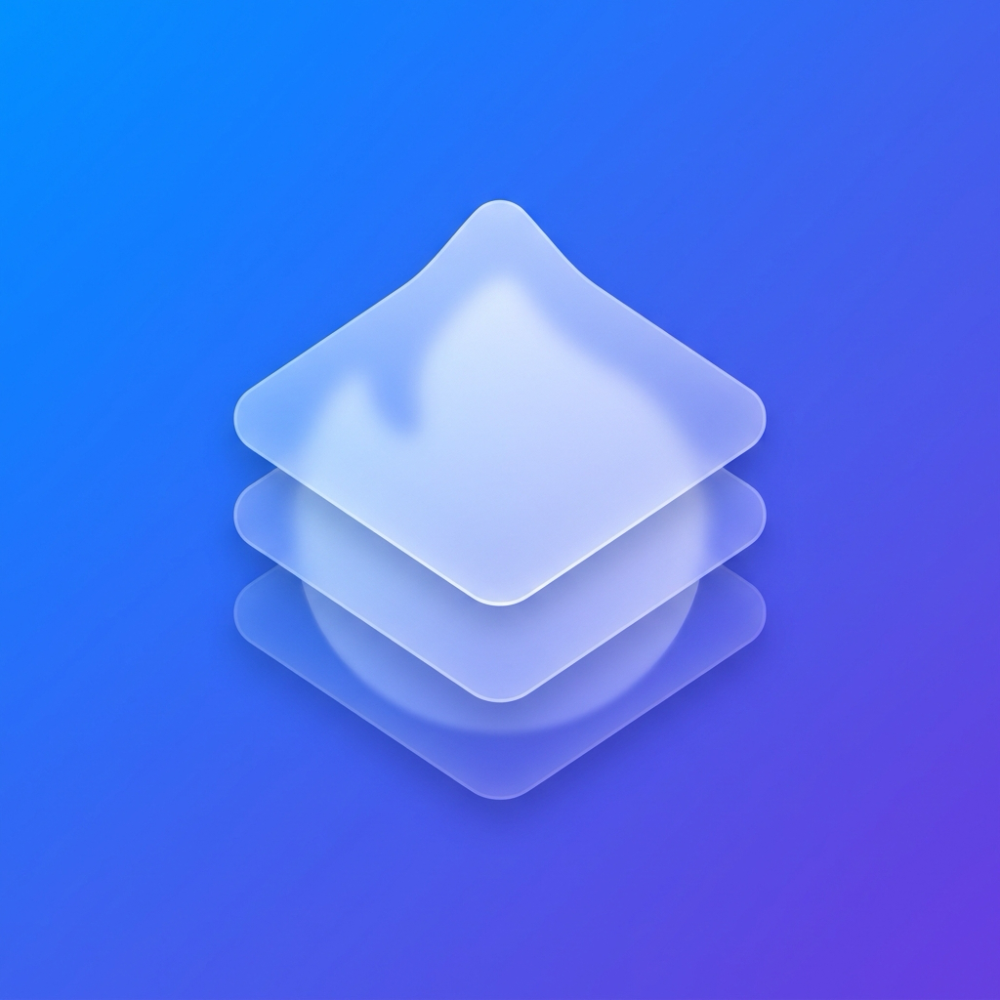

# 回响 (EchoMind)

<p align="center">
  <br />
  <strong>参照 ChatGPT 学习模式 + Claude 分层知识沉淀打造的苏格拉底语音 AI 私教 —— 单一长期会话，用大白话和启发式反问，让每次思考都有回响。</strong>
</p>

---

## 核心特性

1. **类 ChatGPT Study Mode 通俗苏格拉底教学引擎**
   - **轻量摸底**：先感知你的困惑与基础，绝不发冗长问卷。
   - **生活类比讲大白话**：先打通直觉，再引入专业概念，优先引用你已沉淀的知识做类比桥梁。
   - **单点启发式反诘**：每次只抛 1 个小问题引导你自己推导；卡壳时立即换角度给台阶或通俗拆解。
   - **费曼复述巩固**：攻克后邀你用一句话复述并给出记忆锚点。

2. **单一长期会话 + Claude 式分层知识沉淀（`KNOWLEDGE.md` + `docs/`）**
   - **告别碎片化多会话**：唯一一条持续陪伴的学习对话流，上下文达到上限（默认 20 条消息 / 12,000 字）自动沉淀压缩，也支持顶栏随时一键手动沉淀。
   - **`KNOWLEDGE.md`（对标 `CLAUDE.md`）**：纯文本总知识沉淀清单，每次对话自动作为长期记忆地图注入 AI，让私教越用越懂你的知识版图。
   - **`docs/<category>.md`**：按学科/专题/行业自动归类并增量追加结构化 Markdown 沉淀卡片（一句话核心、生活类比、常见误区、费曼复述），左侧抽屉随时翻阅并一键发起苏格拉底复习。

3. **DeepSeek 2026 全栈语音与最新模型能力**
   - **最新对话模型**：默认采用 `deepseek-flash`（支持按需开关深度思考，首字极速响应），同时支持切换 `deepseek-v4-pro`。
   - **DeepSeek ASR 语音转文字**：一键语音提问，自动编码 16kHz 标准 WAV 上传 `/v1/tools/asr`，支持多语种自动识别。
   - **类豆包边生成边自动播报（DeepSeek TTS）**：基于原生 WebSocket `wss://api.deepseek.com/v1/tools/tts` 与四端原生 `audioplayers` 分段 WAV 流式播放，回复边生成边自动朗读，支持 `stella`（海星女声）/ `tide`（暗潮男声）试听切换、顶栏一键静音、随时打断与点击任意气泡重播。

4. **四端原生极简体验**
   - 支持 **Android / iOS / macOS / Windows** 四端原生运行。
   - 设置页极简聚焦：仅保留 DeepSeek API Key / 余额 / 模型、语音交互设置，以及版本检查更新与作者信息。

---

## 本地运行与测试

```bash
# 拉取依赖
flutter pub get

# 静态检查与全量测试
dart analyze
flutter test

# 本地启动（示例：macOS）
flutter run -d macos
```

---

## 作者与项目

- GitHub: [github.com/dstweihao](https://github.com/dstweihao)
- 个人网站: [https://dstweihao.cn](https://dstweihao.cn)
- 微信公众号: `码上生长`
