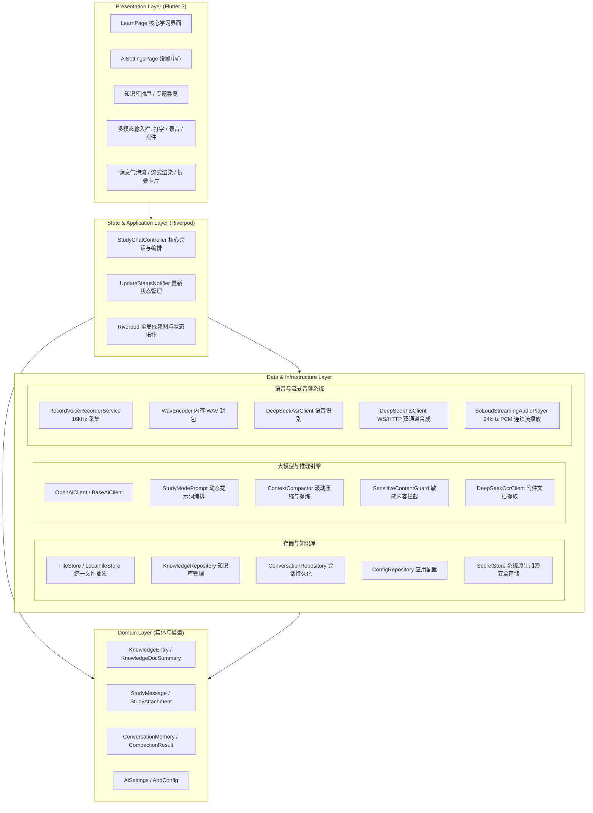
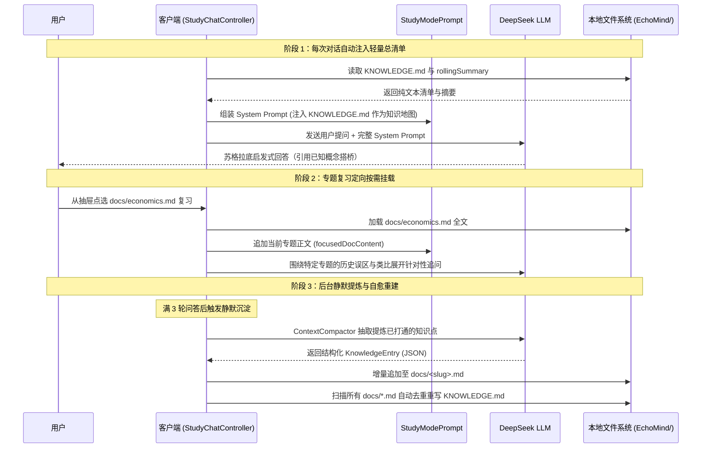
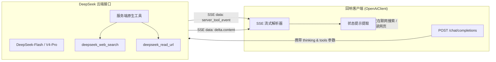
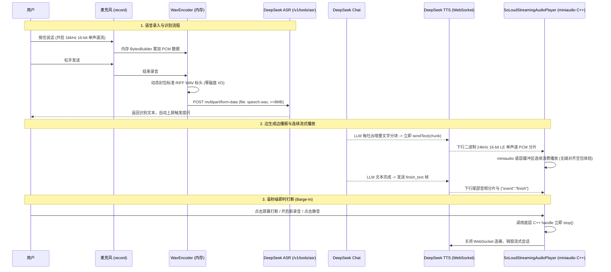

# 回响 (EchoMind) 系统架构设计说明书

> **文档定位**：本文档为「回响 (EchoMind)」客户端的核心系统架构设计全景说明，面向团队工程师与 AI 协作者，阐明系统的分层设计、本地离线知识库机制、外部集成协议以及不可逾越的架构底线。

---

## 1. 系统全景与架构设计

### 1.1 核心定位与设计哲学
回响是一款基于 **Flutter 3** 跨平台框架构建的**本地优先（Local-First）、无服务器（Client-Only）**苏格拉底式启发学习客户端。
其核心哲学是：**拒绝让 AI 一口气灌输现成答案，通过苏格拉底反诘法与生活常识阶梯，引导用户自己推演想通，并将打通的知识无感沉淀至本地纯文本 Markdown 库**。

系统全面运行于端侧设备（Android / iOS / macOS / Windows），直连大模型 API 与本地文件系统，不依赖任何专有云端中转服务器。



### 1.2 分层架构职责划分

| 层次 | 核心模块 / 目录 | 职责范围与设计约束 |
| :--- | :--- | :--- |
| **Presentation (表现层)** | `lib/features/learn/`<br>`lib/features/ai_settings/`<br>`lib/shared/widgets/` | - 负责页面视图构建、手势交互与动画响应。<br>- 严格通过 `ref.watch` / `ref.read` 消费状态，**严禁**直接进行文件 I/O 或原始网络请求。<br>- 负责多模态输入状态切换（长按录音、拖拽附件、快捷启动卡片）。 |
| **Application (状态层)** | `lib/features/learn/study_chat_controller.dart`<br>`lib/providers.dart` | - 基于 Riverpod `Notifier` 与 `Provider` 构建响应式状态图。<br>- 统筹**对话状态流转**、**流式文本与音频的并发协同**、**后台静默提炼调度**与**上下文压缩**。<br>- 确保状态变更时 UI 最小化局部刷新。 |
| **Domain (领域层)** | `lib/domain/models/`<br>`lib/domain/enums/` | - 纯 Dart 领域实体与值对象，无 Flutter 框架依赖，保证高度可测试性。<br>- 封装纯逻辑（如 Slug 跨平台安全清洗、字符数统计、有效对话过滤）。 |
| **Data (数据与基础设施层)** | `lib/data/storage/`<br>`lib/data/repositories/`<br>`lib/data/ai/`<br>`lib/data/voice/`<br>`lib/data/credentials/` | - **Storage**：抽象 `FileStore` 接口，隔离四端平台的文件系统差异。<br>- **AI**：标准化 SSE 解析、模型协议适配（DeepSeek / OpenAI / Anthropic）、服务端工具调用。<br>- **Voice**：底层 C++ FFI 音频管线、WebSocket 实时流式双工通信、无锁内存缓冲。<br>- **Credentials**：基于系统安全存储区保护密钥资产。 |

---

## 2. 本地存储与离线知识库设计

回响坚决贯彻 **Local-First** 思想，用户的所有学习资产均存储在本地可见的文本文件中。

### 2.1 物理存储结构
应用在设备的用户文档目录创建 `EchoMind/` 根目录：

```text
EchoMind/
├── config.yaml           # 模型参数、音色偏好、自动播放等配置（不含 API Key）
├── conversation.json     # 单一长期会话的完整上下文与滚动工作记忆摘要
├── KNOWLEDGE.md          # 长期知识沉淀总清单（全自动注入系统提示词）
└── docs/                 # 按分类/专题持久化的结构化 Markdown 知识卡片库
    ├── economics.md      # 经济学与金融专题卡片集
    ├── programming.md    # 编程与系统设计专题卡片集
    ├── physics.md        # 物理与自然科学专题卡片集
    └── ...               # 自动扩展的各领域 slug 文档
```

### 2.2 知识库双层沉淀与动态装载机制



#### 第一层：`KNOWLEDGE.md` 全局总清单
- **定位**：轻量级长期记忆地图，体积严格精炼。
- **生命周期**：每次与大模型对话时，**全量自动注入系统提示词**，让 AI 随时知晓“用户过去已经学通了哪些概念”，以便在新知识教学中直接拿已知概念作为类比的锚点桥梁。
- **格式规范**：
  ```markdown
  # KNOWLEDGE.md

  ## 经济学与金融 (`docs/economics.md`)
  - **通货膨胀**：货不变、币增发 → 购买力缩水、物价普涨

  ## 编程与架构 (`docs/programming.md`)
  - **递归调用**：大问题拆解为同构子问题，必须有明确出口基线，否则爆栈
  ```

#### 第二层：`docs/<slug>.md` 领域专题卡片
- **定位**：深度的结构化知识卡片库，承载完整思考过程。
- **生命周期**：用户在左侧抽屉浏览查阅，或点击“复习此专题”时，系统将该专题卡片内容定向挂载至提示词，进行针对性复习。
- **存储协议**：按规范化小写 ASCII 标识符 `categorySlug` 分类存储，**只增量追加，永不覆盖历史记录**。
- **卡片四要素结构**：
  ```markdown
  # 经济学与金融

  ## 通货膨胀 `2026-11-19`
  - 核心：货不变、币增发 → 购买力缩水、物价普涨
  - 类比：10只苹果配100元变成配200元，单只苹果单价被迫翻倍
  - 误区：误: 个别菜品涨价就是通胀 → 实: 货币总量超发导致的物价普遍持续上涨
  - 复述：币多货少，钱毛了
  ```

#### 索引自愈与去重机制 (`_rebuildIndex`)
为防止手工编辑文档或多次提炼导致的内容漂移，系统在每次追加写入卡片后，均会完整扫描 `docs/` 下的全部 `.md` 文件：
1. 提取每个专题下的最新一句话核心（同名主题以后写入的为准，自动去重）。
2. 一键自愈并重新生成 `KNOWLEDGE.md`。即使用户手动修改或删除了 `docs/` 下的某个文件，索引列表也能在下次变更时自动纠正一致性。

### 2.3 会话工作记忆与平滑压缩（Context Compactor）

回响采用**单一长期学习会话（Single Lifelong Thread）**设计，免除用户反复新建、切换、管理多会话的认知负担。为了在有限的上下文窗口中保持长期连贯性，系统设计了双层压缩流：

| 触发机制 | 触发阈值 | 运作方式 | 用户感知 |
| :--- | :--- | :--- | :--- |
| **静默自动提炼**<br>(Silent Distillation) | 未提炼新增消息 $\ge 6$ 条<br>（约 3 轮完整问答） | 后台静默调用 AI 提取已学透的硬核知识，存入 `docs/<slug>.md` 并刷新 `KNOWLEDGE.md`；**不改变当前对话列表**。 | 完全无感，聊天窗口保持平滑，不发生跳跃或折叠。 |
| **上下文折叠压缩**<br>(Context Compaction) | 活跃消息数 $\ge 20$ 条<br>或总字符数 $\ge 12,000$ 字<br>（亦支持手动触发） | 将较早消息交给 AI 压缩为 $\le 120$ 字的极简电报体工作记忆摘要（`rollingSummary`），保留最近 4 条原话。旧消息自内存折叠，并在界面插入“已沉淀压缩”提示卡。 | 界面显示温和分隔条，工作记忆无缝续接，有效防止 Token 爆炸与模型幻觉。 |

---

## 3. 外部集成协议规范

### 3.1 DeepSeek 对话与联网检索协议



#### 请求负载规范
采用 OpenAI 兼容格式，并结合 DeepSeek 官方扩展字段：
```json
{
  "model": "deepseek-flash",
  "messages": [
    {"role": "system", "content": "..."},
    {"role": "user", "content": "..."}
  ],
  "stream": true,
  "temperature": 0.3,
  "max_tokens": 4096,
  "thinking": {
    "type": "disabled"
  },
  "tools": [
    {"type": "deepseek_web_search"},
    {"type": "deepseek_read_url"}
  ]
}
```
- **思维链控制**：`deepseek-flash` 默认可开启深度思考。回响在日常对话中默认关闭深度思考以追求极致低延迟与自然口语，用户可在设置中手动激活；激活时显式传递 `thinking.type` 与可选 `reasoning_effort`。
- **服务端搜索感知**：当开启联网检索时，客户端通过解析下行 SSE 中的 `server_tool_event`（`call_started` 事件），无缝捕获大模型正在调用的工具类型，动态将界面状态切换为“正在联网搜索…”或“正在阅读网页…”，让用户清晰感知数据来源。

### 3.2 语音全双工交互管线（录音、ASR、流式 TTS、底层音频驱动）



#### 关键技术参数矩阵

| 阶段 | 核心技术 / 协议 | 音频参数 | 关键设计保证 |
| :--- | :--- | :--- | :--- |
| **麦克风采集** | `record` 库原生录音 | 16,000 Hz, 16-bit, 单声道 PCM | - 内存全缓冲，**不产生任何磁盘垃圾临时文件**。<br>- 振幅流与持续时间流双通道广播，精准驱动录音波形与 120s 倒计时。 |
| **语音识别 (ASR)** | `POST /v1/tools/asr` (`multipart/form-data`) | 16kHz WAV 格式 | - 请求超时限制 30s，硬上限 8MB。<br>- 遇到静音或无有效声音时友好拦截，不浪费 API 请求。 |
| **语音合成 (TTS)** | `wss://api.deepseek.com/v1/tools/tts` | 24,000 Hz, 16-bit LE, 单声道 PCM | - 全双工双向 WebSocket 通道。<br>- 上行发送增量文本帧，下行直接接收裸 PCM 二进制包。<br>- 支持内置音色：`stella`（海星，女声明快）、`tide`（暗潮，男声沉稳）。 |
| **底层播放** | `flutter_soloud` (miniaudio FFI) | 24kHz 实时 PCM 流 | - 彻底摒弃传统“切分成独立 wav/mp3 碎片文件逐个播放”的卡顿方案。<br>- 零文件系统 I/O，零切分断音，整段播报就是一条无缝的连续流。<br>- 内存自动回收（`BufferingType.released`），长对话无内存泄露风险。<br>- 具备毫秒级硬件硬件中断能力（`stop()` 瞬间静音清空底层队列）。 |
| **容灾重播** | `POST /v1/tools/tts` (HTTP 流) | 24kHz PCM | - 提供 HTTP POST 整段拉取方案，专门应对历史消息点播重听或 WebSocket 握手失败时的平滑降级。 |

---

## 4. 架构不可动摇的底线原则

为了保证回响作为个人终身学习工具的纯粹性、可靠性与隐私安全，以下四条底线原则在任何功能迭代中**绝对不可违背**：

### 4.1 无服务器与客户端直连（Serverless & Client-Only）
- **绝不搭建专有中转后端**：应用不存在集中式后端服务器或代理中转层。所有请求由用户客户端直连模型官方 API。
- **免运维与永续可用**：只要 DeepSeek 或标准兼容平台 API 保持开放，客户端即可长期独立运转，不存在“因第三方服务商倒闭而导致软件停摆”的风险。

### 4.2 纯本地存储与数据主权（Local-First & Data Sovereignty）
- **完全归属于用户**：知识库与会话记忆采用开放的 **Markdown** 与 **YAML/JSON** 格式保存于公开的系统文档目录中。
- **零厂商锁定**：用户可以使用任意第三方同步工具（如 **Git**、**iCloud Drive**、**坚果云**、**OneDrive**、**Syncthing**）在多台设备间无缝同步知识库，或者使用 VS Code、Obsidian 直接编辑与双链引用 `docs/` 下的笔记。

### 4.3 严格保护用户隐私与凭据隔离（Privacy & Credential Isolation）
- **系统安全芯片存储**：DeepSeek API Key **严禁**明文保存在 `config.yaml` 或与数据目录一同同步。必须存储在平台级安全区域：
  - macOS / iOS：**Apple Keychain**
  - Android：**Android Keystore / EncryptedSharedPreferences**
  - Windows：**Windows Credential Manager / DPAPI**
- **零数据上报与零埋点**：不收集任何用户学习记录、语音文件、对话日志或行为追踪数据。

### 4.4 拒绝重量级远程依赖（Zero Heavyweight Remote Dependencies）
- **轻量至上**：拒绝引入远程向量数据库（Pinecone、Milvus）、复杂云端 RAG 检索管线或重型嵌入式本地模型。
- **以精巧架构替代庞大系统**：通过双层精炼 Markdown 清单（`KNOWLEDGE.md` + `docs/*.md`）、滚动工作记忆摘要（`rollingSummary`）与大模型自身的上下文理解能力，以数十微秒的文件读取和极精炼的 Token 开销实现卓越的长期记忆效果。
